<!-- Generated by skin/build.py: edit skin/profile.json (words) or skin/render.py (design), not this file. Rebuilt hourly by .github/workflows/skin.yml. -->

<a href="https://github.com/itsoumya-d"><picture><source media="(prefers-color-scheme: dark)" srcset="assets/skin/hero-dark.svg"></picture></a>

<a href="mailto:soumyadebnath1619@gmail.com"><picture><source media="(prefers-color-scheme: dark)" srcset="assets/skin/pill-email-dark.svg"></picture></a> <a href="https://www.linkedin.com/in/soumya-debnath-83a68a237/"><picture><source media="(prefers-color-scheme: dark)" srcset="assets/skin/pill-linkedin-dark.svg"></picture></a> <a href="PROJECTS.md"><picture><source media="(prefers-color-scheme: dark)" srcset="assets/skin/pill-log-dark.svg"></picture></a>

> I build applied AI systems end to end: agent runtimes with safety rails, LLM gateways and evals, research-grade RL experiments, and consumer apps that are live on the App Store and Google Play. Everything here has tests, CI and an honest list of what is not claimed.

 

<picture><source media="(prefers-color-scheme: dark)" srcset="assets/skin/sec-01-dark.svg"></picture>

<picture><source media="(prefers-color-scheme: dark)" srcset="assets/skin/telemetry-dark.svg">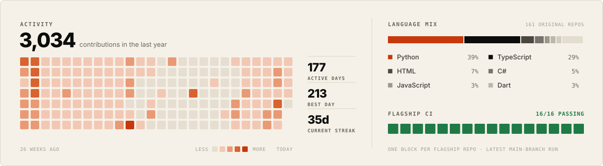</picture>

 

<picture><source media="(prefers-color-scheme: dark)" srcset="assets/skin/sec-02-dark.svg"></picture>

<b>🧠&nbsp; AI / LLM platform</b>&nbsp;&nbsp;Gateways, routing and retrieval that make LLM features cheaper, observable and auditable.

 

<a href="https://github.com/itsoumya-d/llm-control-plane"><picture><source media="(prefers-color-scheme: dark)" srcset="assets/skin/card-llm-control-plane-dark.svg">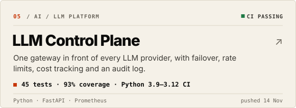</picture></a> <a href="https://github.com/itsoumya-d/RouteLLM-Gateway"><picture><source media="(prefers-color-scheme: dark)" srcset="assets/skin/card-RouteLLM-Gateway-dark.svg">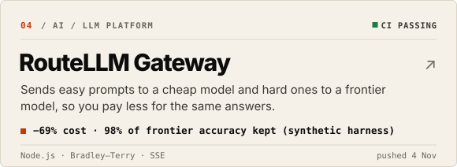</picture></a>

<a href="https://github.com/itsoumya-d/GraphRAG-CodeAudit"><picture><source media="(prefers-color-scheme: dark)" srcset="assets/skin/card-GraphRAG-CodeAudit-dark.svg">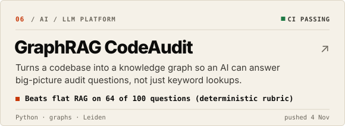</picture></a>

<b>🛡️&nbsp; Agent safety &amp; security</b>&nbsp;&nbsp;Rails for AI agents that touch real systems: approvals, policy checks and cryptographic receipts.

 

<a href="https://github.com/itsoumya-d/HEROS"><picture><source media="(prefers-color-scheme: dark)" srcset="assets/skin/card-HEROS-dark.svg">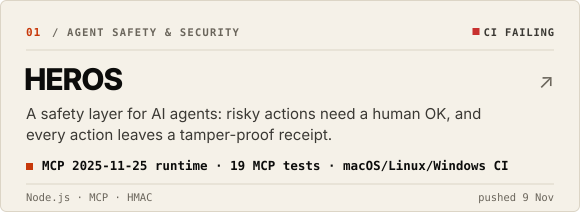</picture></a> <a href="https://github.com/itsoumya-d/HEROS-Firewall"><picture><source media="(prefers-color-scheme: dark)" srcset="assets/skin/card-HEROS-Firewall-dark.svg">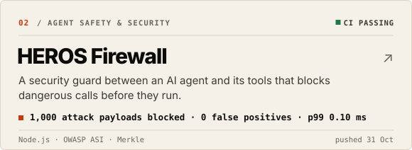</picture></a>

<a href="https://github.com/itsoumya-d/HEROS-Cloud-SaaS"><picture><source media="(prefers-color-scheme: dark)" srcset="assets/skin/card-HEROS-Cloud-SaaS-dark.svg">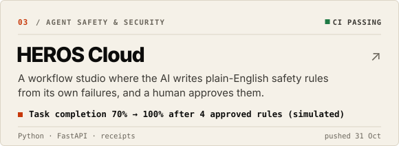</picture></a>

<b>🔬&nbsp; ML / RL research</b>&nbsp;&nbsp;Small, reproducible experiments that isolate one idea and measure it, with GPU-scale runs clearly marked as pending.

 

<a href="https://github.com/itsoumya-d/HEROS-RL"><picture><source media="(prefers-color-scheme: dark)" srcset="assets/skin/card-HEROS-RL-dark.svg">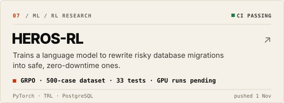</picture></a> <a href="https://github.com/itsoumya-d/Reflexion-SWE"><picture><source media="(prefers-color-scheme: dark)" srcset="assets/skin/card-Reflexion-SWE-dark.svg">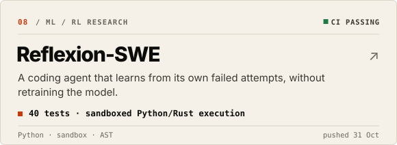</picture></a>

<a href="https://github.com/itsoumya-d/rlvr-bias-probe"><picture><source media="(prefers-color-scheme: dark)" srcset="assets/skin/card-rlvr-bias-probe-dark.svg">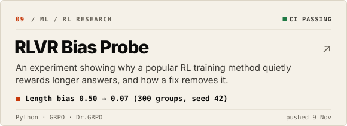</picture></a>

<b>⚡&nbsp; Performance &amp; edge</b>&nbsp;&nbsp;Making AI run fast and private: SIMD kernels, in-browser inference and post-quantum P2P.

 

<a href="https://github.com/itsoumya-d/Anthropic-PerfBench"><picture><source media="(prefers-color-scheme: dark)" srcset="assets/skin/card-Anthropic-PerfBench-dark.svg">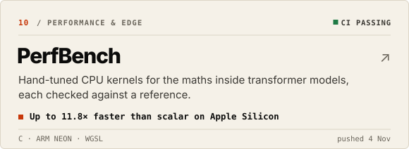</picture></a> <a href="https://github.com/itsoumya-d/edgeinfer"><picture><source media="(prefers-color-scheme: dark)" srcset="assets/skin/card-edgeinfer-dark.svg">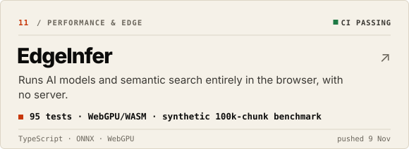</picture></a>

<a href="https://github.com/itsoumya-d/peervault"><picture><source media="(prefers-color-scheme: dark)" srcset="assets/skin/card-peervault-dark.svg">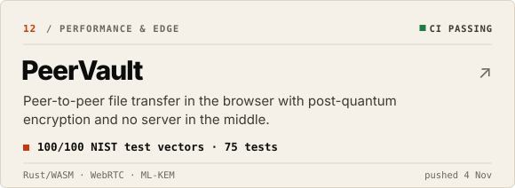</picture></a>

<b>📱&nbsp; Mobile &amp; product</b>&nbsp;&nbsp;Shipped consumer apps with real store listings, plus tooling that turns design references into UI.

 

<a href="https://apps.apple.com/in/app/ctrackai-free-calorie-tracker/id6758379785"><picture><source media="(prefers-color-scheme: dark)" srcset="assets/skin/card-app-ctrackai-dark.svg">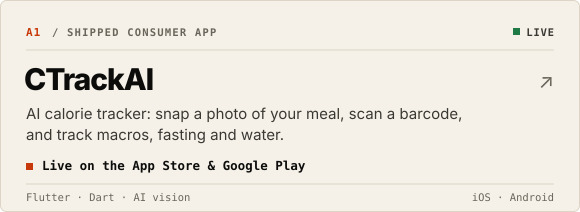</picture></a> <a href="https://apps.apple.com/in/app/preeo-cycle-period-tracker/id6760804568"><picture><source media="(prefers-color-scheme: dark)" srcset="assets/skin/card-app-preeo-dark.svg">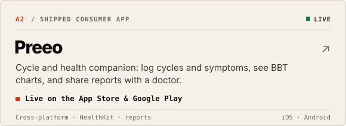</picture></a>

<a href="https://github.com/itsoumya-d/Mobbin-UI-Compiler"><picture><source media="(prefers-color-scheme: dark)" srcset="assets/skin/card-Mobbin-UI-Compiler-dark.svg">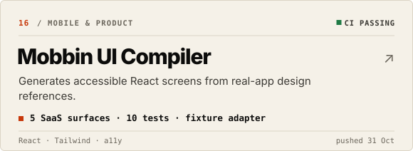</picture></a>

<b>🧱&nbsp; Backend, payments &amp; integration</b>&nbsp;&nbsp;Correctness-first services: idempotency, ledgers, outbox patterns and industrial integrations.

 

<a href="https://github.com/itsoumya-d/go-ledger"><picture><source media="(prefers-color-scheme: dark)" srcset="assets/skin/card-go-ledger-dark.svg">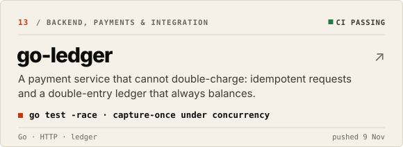</picture></a> <a href="https://github.com/itsoumya-d/factory-monitor"><picture><source media="(prefers-color-scheme: dark)" srcset="assets/skin/card-factory-monitor-dark.svg">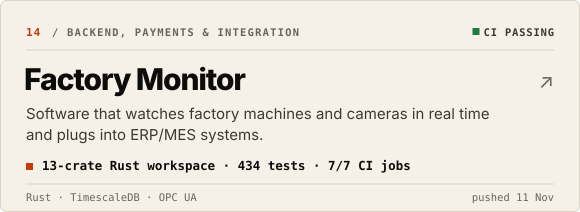</picture></a>

<a href="https://github.com/itsoumya-d/autopilot-fde"><picture><source media="(prefers-color-scheme: dark)" srcset="assets/skin/card-autopilot-fde-dark.svg">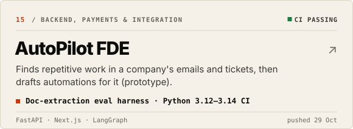</picture></a>

 

<picture><source media="(prefers-color-scheme: dark)" srcset="assets/skin/sec-03-dark.svg"></picture>

<a href="https://github.com/itsoumya-d/HEROS"><picture><source media="(prefers-color-scheme: dark)" srcset="assets/skin/card-HEROS-dark.svg"></picture></a> <a href="https://github.com/itsoumya-d/HEROS-Firewall"><picture><source media="(prefers-color-scheme: dark)" srcset="assets/skin/card-HEROS-Firewall-dark.svg"></picture></a>

<a href="https://github.com/itsoumya-d/RouteLLM-Gateway"><picture><source media="(prefers-color-scheme: dark)" srcset="assets/skin/card-RouteLLM-Gateway-dark.svg"></picture></a> <a href="https://github.com/itsoumya-d/llm-control-plane"><picture><source media="(prefers-color-scheme: dark)" srcset="assets/skin/card-llm-control-plane-dark.svg"></picture></a>

<a href="https://github.com/itsoumya-d/HEROS-RL"><picture><source media="(prefers-color-scheme: dark)" srcset="assets/skin/card-HEROS-RL-dark.svg"></picture></a> <a href="https://github.com/itsoumya-d/Reflexion-SWE"><picture><source media="(prefers-color-scheme: dark)" srcset="assets/skin/card-Reflexion-SWE-dark.svg"></picture></a>

<a href="https://github.com/itsoumya-d/GraphRAG-CodeAudit"><picture><source media="(prefers-color-scheme: dark)" srcset="assets/skin/card-GraphRAG-CodeAudit-dark.svg"></picture></a> <a href="https://github.com/itsoumya-d/Anthropic-PerfBench"><picture><source media="(prefers-color-scheme: dark)" srcset="assets/skin/card-Anthropic-PerfBench-dark.svg"></picture></a>

<b>Show 8 more tracked systems</b>
 

<a href="https://github.com/itsoumya-d/HEROS-Cloud-SaaS"><picture><source media="(prefers-color-scheme: dark)" srcset="assets/skin/card-HEROS-Cloud-SaaS-dark.svg"></picture></a> <a href="https://github.com/itsoumya-d/rlvr-bias-probe"><picture><source media="(prefers-color-scheme: dark)" srcset="assets/skin/card-rlvr-bias-probe-dark.svg"></picture></a>

<a href="https://github.com/itsoumya-d/edgeinfer"><picture><source media="(prefers-color-scheme: dark)" srcset="assets/skin/card-edgeinfer-dark.svg"></picture></a> <a href="https://github.com/itsoumya-d/peervault"><picture><source media="(prefers-color-scheme: dark)" srcset="assets/skin/card-peervault-dark.svg"></picture></a>

<a href="https://github.com/itsoumya-d/go-ledger"><picture><source media="(prefers-color-scheme: dark)" srcset="assets/skin/card-go-ledger-dark.svg"></picture></a> <a href="https://github.com/itsoumya-d/factory-monitor"><picture><source media="(prefers-color-scheme: dark)" srcset="assets/skin/card-factory-monitor-dark.svg"></picture></a>

<a href="https://github.com/itsoumya-d/autopilot-fde"><picture><source media="(prefers-color-scheme: dark)" srcset="assets/skin/card-autopilot-fde-dark.svg"></picture></a> <a href="https://github.com/itsoumya-d/Mobbin-UI-Compiler"><picture><source media="(prefers-color-scheme: dark)" srcset="assets/skin/card-Mobbin-UI-Compiler-dark.svg"></picture></a>

 

<picture><source media="(prefers-color-scheme: dark)" srcset="assets/skin/sec-04-dark.svg"></picture>

<a href="https://apps.apple.com/in/app/ctrackai-free-calorie-tracker/id6758379785"><picture><source media="(prefers-color-scheme: dark)" srcset="assets/skin/card-app-ctrackai-dark.svg"></picture></a> <a href="https://apps.apple.com/in/app/preeo-cycle-period-tracker/id6760804568"><picture><source media="(prefers-color-scheme: dark)" srcset="assets/skin/card-app-preeo-dark.svg"></picture></a>

<b>CTrackAI</b>: <a href="https://apps.apple.com/in/app/ctrackai-free-calorie-tracker/id6758379785">App Store</a> · <a href="https://play.google.com/store/apps/details?id=com.ctrackaiai.nutrition">Google Play</a> · <a href="case-studies/ctrackai-engineering.md">case study</a> &nbsp;·&nbsp; <b>Preeo</b>: <a href="https://apps.apple.com/in/app/preeo-cycle-period-tracker/id6760804568">App Store</a> · <a href="https://play.google.com/store/apps/details?id=com.preeo.health.companion">Google Play</a> · <a href="case-studies/preeo-architecture.md">case study</a>

 

<picture><source media="(prefers-color-scheme: dark)" srcset="assets/skin/sec-05-dark.svg"></picture>

Click a question and GitHub opens an issue with it already filled in. Submit it, and a bot built into this repo replies in the thread, usually within a minute, using **live** data from my repos. I get notified too and often follow up personally.

<a href="https://github.com/itsoumya-d/itsoumya-d/issues/new?template=ask.yml&amp;title=ask%3A%20What%27s%20your%20strongest%20project%3F"><picture><source media="(prefers-color-scheme: dark)" srcset="assets/skin/ask-strongest-dark.svg"></picture></a> <a href="https://github.com/itsoumya-d/itsoumya-d/issues/new?template=ask.yml&amp;title=ask%3A%20What%20are%20you%20building%20right%20now%3F"><picture><source media="(prefers-color-scheme: dark)" srcset="assets/skin/ask-now-dark.svg"></picture></a>

<a href="https://github.com/itsoumya-d/itsoumya-d/issues/new?template=ask.yml&amp;title=ask%3A%20How%20do%20you%20prove%20your%20code%20works%3F"><picture><source media="(prefers-color-scheme: dark)" srcset="assets/skin/ask-quality-dark.svg"></picture></a> <a href="https://github.com/itsoumya-d/itsoumya-d/issues/new?template=ask.yml&amp;title=ask%3A%20Are%20you%20open%20to%20relocation%20or%20remote%3F"><picture><source media="(prefers-color-scheme: dark)" srcset="assets/skin/ask-relocation-dark.svg"></picture></a>

<a href="https://github.com/itsoumya-d/itsoumya-d/issues/new?template=ask.yml&amp;title=ask%3A%20How%20do%20you%20work%20with%20AI%20coding%20agents%3F"><picture><source media="(prefers-color-scheme: dark)" srcset="assets/skin/ask-agents-dark.svg"></picture></a> <a href="https://github.com/itsoumya-d/itsoumya-d/issues/new?template=ask.yml&amp;title=ask%3A%20What%27s%20your%20tech%20stack%3F"><picture><source media="(prefers-color-scheme: dark)" srcset="assets/skin/ask-stack-dark.svg"></picture></a>

<a href="https://github.com/itsoumya-d/itsoumya-d/issues/new?template=ask.yml&amp;title=ask%3A%20"><picture><source media="(prefers-color-scheme: dark)" srcset="assets/skin/ask-custom-dark.svg"></picture></a>

💬 Be the first to ask · you can also name any repo, e.g. <i>ask: tell me about PeerVault</i>

 

<picture><source media="(prefers-color-scheme: dark)" srcset="assets/skin/sec-06-dark.svg">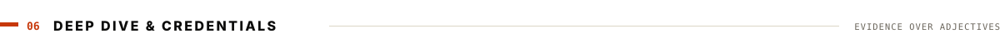</picture>

| Go deeper | What you'll find |
|:--|:--|
| 📚 **[Full engineering log](PROJECTS.md)** | Every project with its exact test counts, metrics and honest limits |
| 🧾 **[Evidence matrix](EVIDENCE.md)** · **[Release audit](AUDIT.md)** | What was measured, how, and what is explicitly not claimed |
| 🧪 **Case studies** | [CTrackAI](case-studies/ctrackai-engineering.md) · [Preeo](case-studies/preeo-architecture.md) · [FieldLens](case-studies/fieldlens-offline-engine.md) |
| 🤗 **[Hugging Face](https://huggingface.co/itssoumyad)** | 11 live Spaces · 2 datasets · [portfolio hub](https://huggingface.co/spaces/itssoumyad/portfolio) |
| 🎓 Anthropic · Building with the Claude API | [verify credential](https://academy.claude.com/badges/f1de3ec2-3d44-48a9-a1fe-3d05f9f1122a) |
| 🎓 Anthropic · Claude Code in Action | [verify credential](https://academy.claude.com/badges/fd1a399f-5fe9-4635-977c-440cab5eb62c) |
| 🎓 Anthropic · MCP: Advanced Topics | [verify credential](https://academy.claude.com/badges/2cc5045b-85c1-43cd-aeb8-e0ea7f3dac59) |
| 🎓 Anthropic · Teaching AI Fluency | [verify credential](https://academy.claude.com/badges/236d54cb-6398-4302-8726-f037c92a3e51) |
| 🎓 HackerRank · SQL (Intermediate) | [verify credential](https://www.hackerrank.com/certificates/c5a80e6adda0) |

 

This README rebuilds itself every hour from live GitHub and Hugging Face data · last change 2026-11-10 · engine: <a href="skin/build.py">skin/build.py</a>

